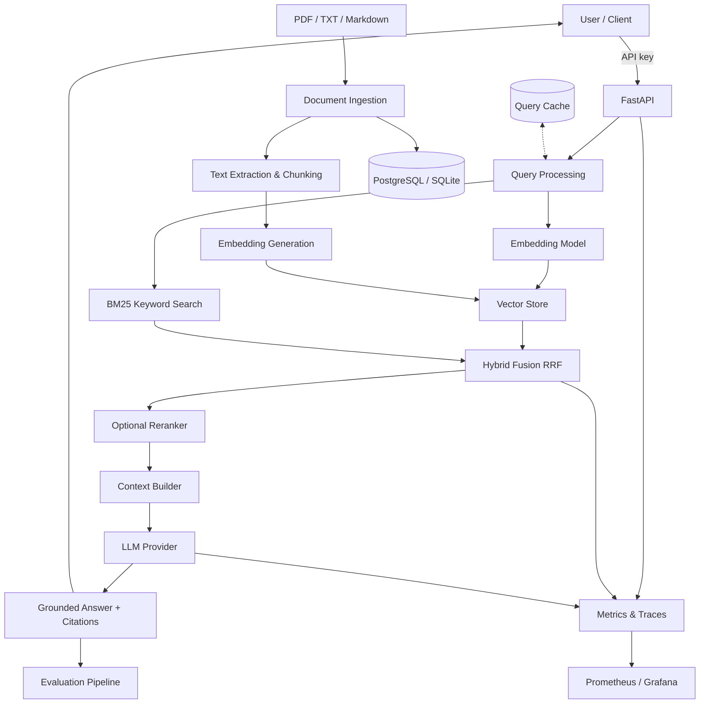

# Production RAG Platform

[](https://www.python.org/)
[](https://fastapi.tiangolo.com/)
[](https://www.docker.com/)
[](.github/workflows/ci.yml)
[](LICENSE)

> An open-source reference implementation for building reliable, observable, and evaluable RAG systems.

## Overview

Building a document chatbot is relatively straightforward. Building a RAG application that retrieves the right information, cites its sources, handles failures, and can be evaluated in production is a different challenge.

**Production RAG Platform** provides a modular foundation for the entire RAG lifecycle:

- Document ingestion and processing
- Chunking, embeddings, and vector indexing
- Semantic and hybrid retrieval
- Context-grounded LLM responses with citations
- Retrieval and answer quality evaluation
- Latency, token usage, cost, and error monitoring
- API-key authentication with tenant isolation
- Containerized deployment and automated testing

The platform ships working defaults that need no API keys or model downloads (deterministic hashing embeddings + a stub LLM), so you can run the full stack — ingest, query, evaluate, observe — out of the box, then swap in real providers via configuration.

## Key Features

### Document ingestion

- Upload and index PDF, TXT, and Markdown documents (page-aware for PDFs).
- Extract text and split documents into configurable, paragraph-aware chunks that never span pages — every citation carries an exact page number.
- Preserve source metadata, page numbers, and document identifiers.
- Content-based duplicate detection (per tenant) and idempotent re-indexing.
- Update documents in place with `PUT /documents/{id}`; delete with `DELETE`.
- Optional background indexing workers (`INGESTION_MODE=background`): index requests return `202` and documents transition `uploaded → indexed/failed` asynchronously.

### Retrieval engine

- Semantic search using vector embeddings.
- Hybrid retrieval: a pure-Python BM25 keyword index fused with vector results via reciprocal rank fusion.
- Agentic retrieval (`mode="agentic"`): compound questions are decomposed into focused sub-queries (LLM-assisted when a real provider is configured, heuristic otherwise), each is retrieved separately, and the result lists are fused with RRF for better coverage.
- Configurable chunk size and overlap.
- Metadata filtering (document ids, tenant scoping enforced server-side).
- Optional cross-encoder reranking.
- Built-in query cache (TTL-based, invalidated automatically whenever the corpus changes).

### Grounded question answering

- Generate answers strictly from retrieved context, with `[n]` citations resolved back to chunks.
- Refuse to answer when the context is insufficient instead of inventing content.
- Prompts treat document content as untrusted data (prompt-injection defense).
- Configurable prompts (versioned for evaluation) and model providers.
- Streaming responses via server-sent events (`/query/stream`).
- Server-side conversation sessions: threads are persisted per tenant (`/conversations`), and clients continue a thread by sending `conversation_id` instead of replaying history — follow-up questions are answered with the stored context.

### Authentication and multi-tenancy

- API-key auth (`AUTH_ENABLED` + `API_KEYS`), accepted as `X-API-Key` or `Authorization: Bearer`.
- Each key maps to a tenant; documents and query results are isolated per tenant at the storage and retrieval layers.
- Optional per-key request quotas (`API_KEYS=sk-team-a:acme:60`); exceeding a quota returns `429` with `Retry-After` and is tracked as a metric.
- Maintenance endpoints (e.g. retention sweeps) are gated behind `ADMIN_KEYS`.
- `/health` and `/metrics` stay open for probes and scraping.

### Evaluation and quality assurance

- Versioned JSONL evaluation datasets.
- Retrieval metrics: Recall@K, Precision@K, MRR.
- Context coverage plus answer heuristics: faithfulness, answer relevance, citation precision.
- LLM-as-judge grading (`--judge`): the configured LLM scores faithfulness, relevance, and citation support on a rubric; falls back to the lexical heuristics when only the stub provider is available, and every score carries provenance in the report.
- Compare chunking, embeddings, retrieval, and prompt configurations against recorded baselines.
- Evaluation smoke test runs in CI.

### Observability

- Request latency, error rate, and throughput; per-route histograms.
- Retrieval latency and retrieved-chunk counts; query cache hit/miss.
- Token consumption and estimated cost per request (`usage.cost_usd` + `rag_llm_cost_usd_total`).
- Per-API-key quota rejections (`rag_auth_quota_rejections_total`).
- Prometheus metrics endpoint and a provisioned Grafana dashboard.
- Structured JSON logs with request IDs; document content is never logged.
- Optional OpenTelemetry tracing.

### Lifecycle management

- Retention policy (`RETENTION_DAYS`): documents untouched for N days are removed by a background sweeper and on demand via `POST /maintenance/retention`; a document's age resets whenever it is re-indexed or replaced.

## Architecture



## Technology Stack

| Component | Technology |
|---|---|
| Language | Python 3.11+ |
| API | FastAPI, Pydantic v2 |
| Document processing | PyMuPDF, standard text parsers |
| Embeddings | Sentence Transformers or an OpenAI-compatible API (deterministic hashing fallback) |
| Vector database | Qdrant (production), file-backed local store (dev), in-memory (tests) |
| Retrieval | Custom pipeline with built-in BM25 + RRF fusion |
| Reranking | Cross-encoder via sentence-transformers (optional) |
| LLM | Any OpenAI-compatible API, or a deterministic stub for offline work |
| Persistence | PostgreSQL or SQLite via SQLAlchemy |
| Evaluation | pytest + custom datasets and metrics |
| Observability | Prometheus, Grafana, optional OpenTelemetry |
| Packaging | Docker, Docker Compose, Kubernetes manifests |
| CI/CD | GitHub Actions |

All providers (embeddings, vector store, LLM) live behind interfaces — swapping one is a configuration change. Add new backends by subclassing `EmbeddingProvider`, `VectorStore`, or `LLMProvider`.

## Project Structure

```text
production-rag-platform/
├── app/
│   ├── main.py                  # App factory, middleware, lifespan
│   ├── api/
│   │   ├── routes/
│   │   │   ├── documents.py     # Upload / index / update / list / delete
│   │   │   ├── query.py         # /query, /query/stream (SSE), /retrieval/preview
│   │   │   ├── conversations.py # Server-side chat sessions
│   │   │   ├── maintenance.py   # Retention sweeps (admin-gated)
│   │   │   └── health.py        # /health
│   │   ├── auth.py              # API keys → tenant mapping, quotas, admin keys
│   │   ├── dependencies.py      # ServiceContainer wiring
│   │   └── schemas.py           # Request/response models
│   ├── core/
│   │   ├── config.py            # Validated settings (pydantic-settings)
│   │   ├── logging.py           # Structured logs + request IDs
│   │   └── ratelimit.py         # Shared sliding-window limiter (IP + per-key quotas)
│   ├── ingestion/
│   │   ├── loaders.py           # PDF / TXT / Markdown extraction
│   │   ├── chunking.py          # Paragraph-aware chunking
│   │   ├── pipeline.py          # Ingest / index / replace / delete
│   │   ├── retention.py         # Retention sweeps (background + on demand)
│   │   └── worker.py            # Background indexing workers
│   ├── retrieval/
│   │   ├── embeddings.py        # hashing / sentence-transformers / openai
│   │   ├── vector_store.py      # local / in-memory / Qdrant
│   │   ├── hybrid_search.py     # BM25 + RRF hybrid and agentic retriever
│   │   ├── query_decomposer.py  # Sub-query decomposition for agentic mode
│   │   └── reranker.py          # Optional cross-encoder reranking
│   ├── generation/
│   │   ├── prompts.py           # Grounded prompt templates (versioned)
│   │   └── answer.py            # Answer service, cache, LLM providers
│   ├── evaluation/
│   │   ├── datasets.py          # JSONL dataset loading
│   │   ├── metrics.py           # Recall@K / Precision@K / MRR / answer heuristics
│   │   ├── judge.py             # LLM-as-judge rubric grading
│   │   └── runner.py            # CLI evaluation runner (--with-answers, --judge)
│   ├── observability/
│   │   ├── metrics.py           # Prometheus metrics + /metrics endpoint
│   │   └── tracing.py           # Optional OpenTelemetry
│   └── storage/
│       ├── database.py          # Engine, Document/Conversation models, schema upgrades
│       └── repository.py        # Tenant-scoped document + conversation repositories
├── tests/
│   ├── unit/                    # Chunking, BM25, metrics, auth, cache…
│   ├── integration/             # Full API tests with stub providers
│   └── evaluation/              # Runner smoke test
├── evals/
│   └── sample_questions.jsonl   # Versioned evaluation dataset
├── samples/                     # Sample corpus for the quickstart
├── scripts/
│   ├── ingest_documents.py      # Ingest files/directories from the CLI
│   └── query.py                 # Ask questions from the CLI
├── deploy/kubernetes/           # Namespace, StatefulSets, Deployment, HPA, Ingress
├── docker/                      # Prometheus config, Grafana provisioning + dashboard
├── docs/
│   ├── architecture.md          # Design decisions and module walkthrough
│   └── evaluation.md            # Metrics definitions and baseline workflow
├── .github/workflows/ci.yml     # Lint, tests, evaluation smoke
├── .env.example
├── Dockerfile
├── compose.yaml                 # api + postgres + qdrant + prometheus + grafana
├── pyproject.toml
├── LICENSE
└── README.md
```

## Getting Started

### Prerequisites

- Python 3.11 or newer
- Git
- Docker and Docker Compose (optional, for the full stack)
- An LLM and embedding provider, or just use the built-in defaults

### 1. Clone and set up a virtual environment

```bash
git clone https://github.com/NotHarshhaa/production-rag-platform.git
cd production-rag-platform

python -m venv .venv
source .venv/bin/activate          # Windows PowerShell: .venv\Scripts\Activate.ps1
```

### 2. Install dependencies

```bash
pip install -e ".[dev]"
```

Optional extras:

```bash
pip install -e ".[embeddings-local]"   # local sentence-transformers models
pip install -e ".[otel]"               # OpenTelemetry tracing
```

### 3. Configure environment variables

```bash
cp .env.example .env
```

The defaults work with zero configuration. Useful switches:

```dotenv
EMBEDDING_PROVIDER=sentence-transformers   # real semantic embeddings
LLM_PROVIDER=openai                        # any OpenAI-compatible API
LLM_MODEL=gpt-4o-mini
LLM_API_KEY=sk-...
VECTOR_STORE=qdrant                        # production vector store
AUTH_ENABLED=true                          # require API keys
API_KEYS=sk-team-a:acme:60,sk-team-b:globex  # key:tenant[:quota-per-minute] pairs
ADMIN_KEYS=sk-team-a                       # keys allowed to run maintenance endpoints
RETENTION_DAYS=90                          # delete documents untouched for 90 days
```

### 4. Ingest, query, evaluate

```bash
# Ingest the sample corpus (PDF/TXT/Markdown from any directory)
python scripts/ingest_documents.py samples/

# Ask a question from the CLI
python scripts/query.py "How does the deployment pipeline validate changes?"

# Run the evaluation suite (retrieval-only, no LLM calls)
python -m app.evaluation.runner

# Full evaluation including generated answers and answer metrics
python -m app.evaluation.runner --with-answers
```

### 5. Run the API

```bash
uvicorn app.main:app --reload
```

- Interactive Web UI: <http://localhost:8000>
- API documentation: <http://localhost:8000/docs>
- Health endpoint: <http://localhost:8000/health>
- Metrics: <http://localhost:8000/metrics>

### 6. Run the full stack with Docker Compose

```bash
docker compose up --build
```

This starts the API, PostgreSQL, Qdrant, Prometheus (<http://localhost:9090>), and Grafana (<http://localhost:3000>, admin/admin) with a pre-provisioned **RAG Platform Overview** dashboard.

Kubernetes manifests (Deployment, StatefulSets, HPA, Ingress) live in [`deploy/kubernetes/`](deploy/kubernetes/).

## Example API Workflow

| Method | Endpoint | Purpose |
|---|---|---|
| POST | `/documents/upload` | Upload a document (`?auto_index=true` to index immediately) |
| POST | `/documents/{id}/index` | Index or re-index a document |
| PUT | `/documents/{id}` | Replace a document's content and re-index |
| GET | `/documents` | List indexed documents |
| GET/DELETE | `/documents/{id}` | Inspect or delete a document |
| GET | `/documents/{id}/chunks` | Inspect all indexed chunks and pages for a document |
| POST | `/retrieval/preview` | Preview retrieval, BM25, vector scores, and agentic sub-queries without LLM generation |
| GET | `/documents/{id}/download` | Download original uploaded document file |
| GET | `/documents/{id}/raw` | Retrieve concatenated full raw text extracted from document |
| POST | `/query` | Ask a question against indexed content (`conversation_id` to continue a stored thread) |
| POST | `/query/stream` | Stream an answer via server-sent events |
| POST | `/conversations` | Start a server-side conversation session |
| GET | `/conversations` | List saved conversations (most recently active first) |
| GET/PATCH/DELETE | `/conversations/{id}` | Fetch with messages, rename, or delete a conversation |
| POST | `/maintenance/retention` | Apply the retention policy immediately (requires `ADMIN_KEYS` when auth is on) |
| GET | `/health` | Check service health (includes document/chunk stats) |
| GET | `/metrics` | Expose Prometheus metrics |

Upload a document and index it:

```bash
curl -F "file=@report.pdf" http://localhost:8000/documents/upload
curl -X POST http://localhost:8000/documents/<document_id>/index
```

Ask a question:

```json
{
  "question": "How does the deployment pipeline work?",
  "top_k": 5,
  "include_citations": true
}
```

Example response:

```json
{
  "answer": "The deployment pipeline validates changes before deployment.",
  "citations": [
    {
      "document_id": "doc_001",
      "document_name": "deployment.md",
      "page": 4,
      "chunk_id": "doc_001:18",
      "score": 0.032
    }
  ],
  "retrieval": {
    "chunks_returned": 5,
    "latency_ms": 1.1,
    "mode": "hybrid",
    "reranked": false
  },
  "usage": {
    "prompt_tokens": 812,
    "completion_tokens": 96,
    "total_tokens": 908,
    "cost_usd": 0.000284,
    "model": "gpt-4o-mini"
  },
  "insufficient_context": false,
  "cached": false,
  "latency_ms": 127.4
}
```

With authentication enabled, send the key with every request:

```bash
curl -H "X-API-Key: sk-team-a" http://localhost:8000/query
```

### Multi-turn conversations (server-side sessions)

```bash
# Start a session, then continue it by id — history is stored server-side.
CONV=$(curl -s -X POST http://localhost:8000/conversations | python -c "import sys,json;print(json.load(sys.stdin)['id'])")

curl -s http://localhost:8000/query -H "Content-Type: application/json" -d "{
  \"question\": \"How does the deployment pipeline work?\",
  \"conversation_id\": \"$CONV\"
}"

curl -s http://localhost:8000/query -H "Content-Type: application/json" -d "{
  \"question\": \"What happens if a release fails?\",
  \"conversation_id\": \"$CONV\"
}"

# Inspect, rename, or delete the thread.
curl http://localhost:8000/conversations/$CONV
curl -X PATCH http://localhost:8000/conversations/$CONV \
  -H "Content-Type: application/json" -d '{"title": "Deploy pipeline"}'
curl -X DELETE http://localhost:8000/conversations/$CONV
```

### Agentic retrieval for compound questions

```bash
curl -s http://localhost:8000/query -H "Content-Type: application/json" -d '{
  "question": "How does deployment work and also how does rollback work?",
  "mode": "agentic"
}'
```

The question is decomposed into sub-queries, each is retrieved (hybrid by
default), and the results are fused with reciprocal rank fusion. Preview the
decomposition without an LLM call via `POST /retrieval/preview` with
`"mode": "agentic"` — the response includes the `subqueries` that were fused.

## Evaluation Strategy

A RAG system should be evaluated at both the retrieval and generation layers.

| Area | Measurement |
|---|---|
| Retrieval quality | Recall@K, Precision@K, MRR |
| Context quality | Keyword coverage of retrieved chunks |
| Answer quality | Faithfulness and answer relevance (lexical heuristics) |
| Grounding | Citation correctness against retrieved evidence |
| Reliability | Request success rate and error rate |
| Performance | p50/p95 latency and throughput |
| Cost | Tokens and estimated cost per request |

Start with a small, manually reviewed question-answer dataset (`evals/sample_questions.jsonl` is a working example). Record a baseline before changing chunking, embeddings, retrieval algorithms, or prompts, then compare reports. See [`docs/evaluation.md`](docs/evaluation.md) for metric definitions and the full workflow.

Automated evaluation scores are useful signals, not proof that every answer is correct. Validate important results against human-reviewed examples.

## Security and Reliability

Implemented in this repository:

- File-type allow list and upload size limits enforced before the body is read.
- Retrieved documents treated as untrusted input; prompts instruct the model to ignore embedded instructions.
- API-key authentication with tenant isolation — one tenant's documents can never leak into another tenant's results.
- Per-key request quotas (`key:tenant:quota` entries in `API_KEYS`) with 429 + `Retry-After` on exhaustion.
- Maintenance endpoints gated behind `ADMIN_KEYS` when auth is enabled.
- Retention policies to expire stale documents automatically.
- Query-result cache invalidated on every corpus change.
- API keys and credentials stay out of source control (`.env` is gitignored).
- No document text or secrets in logs — only ids, statuses, and timings.
- Timeouts and retries on external model calls; optional per-IP rate limiting.
- `/health` and `/metrics` are the only unauthenticated endpoints.

Still open for production hardening: backup/restore procedures and full RBAC beyond tenant scoping and admin keys.

RAG does not automatically prevent prompt injection or guarantee factual responses. Production deployments need explicit security controls and testing.

## Development Roadmap

### Phase 1 — Working RAG MVP ✅

- [x] FastAPI application and health endpoint
- [x] PDF, TXT, and Markdown ingestion
- [x] Chunking and embeddings
- [x] Vector storage and semantic search
- [x] Question-answer endpoint with citations
- [x] Unit and integration tests

### Phase 2 — Retrieval Improvements ✅

- [x] Hybrid search (BM25 + RRF fusion)
- [x] Metadata filtering (documents, tenants)
- [x] Configurable chunking
- [x] Optional reranking
- [x] Document update and deletion workflows

### Phase 3 — Evaluation ✅

- [x] Versioned evaluation dataset
- [x] Retrieval metrics (Recall@K, Precision@K, MRR)
- [x] Answer faithfulness evaluation
- [x] Citation verification
- [x] Regression checks in CI

### Phase 4 — Production Operations ✅

- [x] Docker Compose deployment
- [x] Structured logs; optional distributed tracing
- [x] Prometheus metrics and Grafana dashboards
- [x] Request timeouts, retries, and rate limiting
- [x] Token usage and cost tracking

### Phase 5 — Advanced Capabilities ✅

- [x] Streaming responses
- [x] Background ingestion workers
- [x] Authentication and multi-user access
- [x] Pluggable model and vector-store adapters
- [x] Query result caching
- [x] Kubernetes deployment examples
- [x] Agentic retrieval (query decomposition + multi-query fusion)
- [x] LLM-as-judge evaluation (built-in rubric grader with heuristic fallback)
- [ ] pgvector adapter
- [ ] Alembic schema migrations

### Phase 6 — Platform Hardening ✅

- [x] Server-side conversation sessions (`/conversations` + `conversation_id`)
- [x] Document retention policy (`RETENTION_DAYS` + `POST /maintenance/retention`)
- [x] Per-API-key quotas and admin keys for maintenance endpoints
- [x] Agentic retrieval preview in the debugging endpoint

## Contributing

Contributions are welcome!

1. Fork the repository.
2. Create a feature branch.
3. Add tests for new functionality.
4. Run formatting, linting, and tests:

   ```bash
   ruff check app scripts tests
   pytest
   ```

5. Open a pull request describing the change.

Potential contribution areas include retrieval algorithms, evaluation datasets, provider integrations, observability, security, and deployment automation.

## License

This project is licensed under the [MIT License](LICENSE).

## Author

**NotHarshhaa**

- GitHub: [@NotHarshhaa](https://github.com/NotHarshhaa)

If you find this project useful, consider giving it a star and contributing improvements.

---

**Build RAG systems that can be evaluated, observed, and operated — not just demonstrated.**
